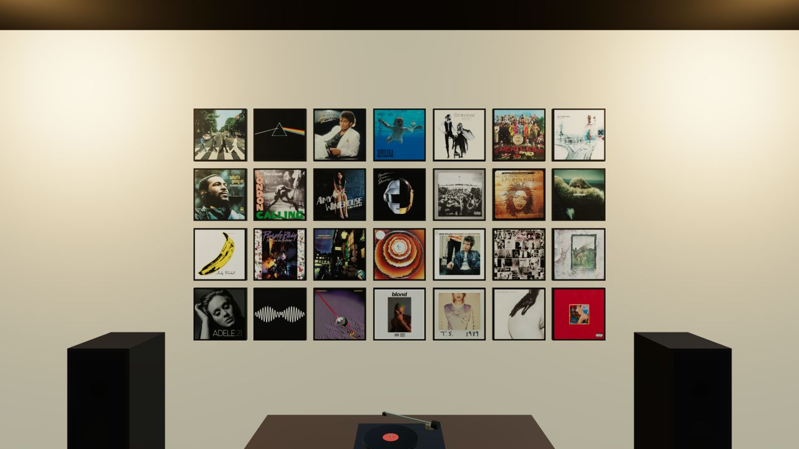

# Stacks — a 3D vinyl listening room

An interactive 3D web app: walk into a cozy listening room, hang album art on
the walls, and click a record to drop it on the turntable and play it. Swap the
view outside the windows between three moods, including a full disco mode.

**This is just for fun** — it's meant to be left open in a tab while you work
or chill: a calm little room with your music playing and a view outside.

The **highlight is the album wall art** — curating a wall of cover art you love
is the heart of the app; everything else (the room, the turntable, the themes)
is the backdrop for it.

Built with React Three Fiber. The app runs in the browser with no application backend. Album lookup, cover art, and playback use external services.



## Features

- **3D listening room** — couch, hi‑fi turntable + speakers, credenza, plants,
  and floor‑to‑ceiling windows, lit with image‑based lighting.
- **Wall art grids** — click a wall to focus it, then pick album art from a
  searchable catalog and hang it. Your library persists in `localStorage`.
- **Reliable cover art** — album metadata + artwork from
  [MusicBrainz](https://musicbrainz.org/) and the
  [Cover Art Archive](https://coverartarchive.org/). Singles, EPs and duplicate
  re‑releases are filtered out so the wall stays clean.
- **Play a record** — click any placed sleeve and it flies onto the turntable;
  the platter spins, the tonearm drops, and audio plays via a hidden YouTube
  player. A bottom transport bar shows what's spinning.
- **Three outside themes** — switch the world beyond the windows (and the room
  lighting that goes with it):
  - 🌿 **Rainforest** — lush daylight forest
  - ❄️ **Winter day** — bright snowy woods
  - 🪩 **Disco** — Shanghai night skyline, with a mirror ball, sweeping beams,
    pulsing colored lights, back‑wall uplighting, and a color‑cycling dance
    floor.
- Hover a placed sleeve for a corner ✕ to remove it.

## Quick start

```bash
npm install
cp .env.example .env.local   # then add your YouTube API key (see below)
npm run dev
```

Open the printed local URL.

### YouTube API key (required for playback)

Searching for an album's audio uses the official YouTube Data API v3, which
needs a Google Cloud API key. Available quota and playback depend on YouTube.

Put it in `.env.local`:

```env
VITE_YOUTUBE_API_KEY=your-key-here
```

Full step‑by‑step setup: [`docs/youtube-api-key.md`](docs/youtube-api-key.md).
Without a key the room still works fully — only audio playback is disabled, and
the player bar will tell you a key is needed.

## Scripts

| Command | What it does |
| --- | --- |
| `npm run dev` | Start the Vite dev server |
| `npm run build` | Type‑check and build for production |
| `npm run preview` | Preview the production build |
| `npm run typecheck` | Run `tsc --noEmit` |

## Project structure

```
src/
  scene/        R3F scene: Room, Furniture, WallGrid, Sky, DiscoLights,
                DanceFloor, CameraRig, VinylSleeve, PlayingSleeve, …
  ui/           DOM overlays: HUD, AlbumPicker, SearchResults, PlayerBar
  state/        Zustand stores: library, focus, player, theme
  services/     musicbrainz, coverArt, youtubePlayer
  lib/          geometry + tween helpers
public/textures/  bundled equirect skies (LDR JPG + HDR for IBL)
docs/             setup docs
```

## Tech

React 18 · TypeScript · Vite · three.js · @react-three/fiber · @react-three/drei
· Zustand · Tailwind CSS

## Data sources & licensing

- Album metadata/artwork: MusicBrainz + Cover Art Archive (respect their terms, artwork rights, and rate limits).
- Sky environments: CC0 HDRIs from [Poly Haven](https://polyhaven.com/).
- Audio: streamed from YouTube via the user‑provided API key.

This project is for personal/local use.
