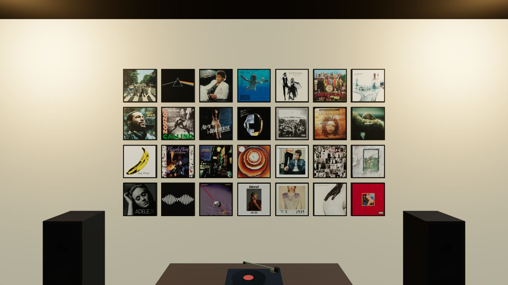

# Stacks

A 3D vinyl listening room for the browser. Arrange album covers on the walls,
pick a record for the turntable, and switch the room between rainforest, winter,
and disco settings.



An existing in-app capture of a populated album wall.

- Find albums through MusicBrainz and the Cover Art Archive.
- Keep your album wall in the browser's local storage.
- Play audio through YouTube with your own YouTube Data API key.

This is a personal, local-use project built with React Three Fiber, Three.js,
TypeScript, and Zustand. It has no application backend; album lookup, cover art,
and playback use external services.

## Run locally

```sh
npm ci
npm run dev
```

Open the local URL printed by Vite. The room and album wall work without a key.
For playback, copy `.env.example` to `.env.local`, set `VITE_YOUTUBE_API_KEY`,
and follow the [YouTube setup guide](docs/youtube-api-key.md).

`npm run build` type-checks and builds the app; `npm run preview` serves the build.
See the [full guide](GUIDE.md) for controls, themes, scripts, and project structure.

## Sources and attribution

Album metadata and artwork come from [MusicBrainz](https://musicbrainz.org/) and
the [Cover Art Archive](https://coverartarchive.org/). Sky environments are CC0
HDRIs from [Poly Haven](https://polyhaven.com/). Audio streams from YouTube.
Those sources retain their own terms; this repository does not grant rights to
third-party album artwork or music.
